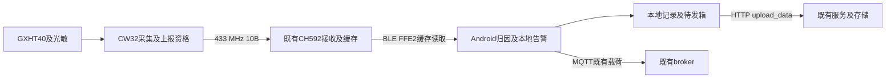

# 传感器遥测与 App 消费接口契约（IC-002）

版本：4.0。负责角色：系统架构。状态：CONTRACT_READY（已知接口可供实现和验证；不表示无光数值判据、设备链路或生产上传已验收）。

基线：`597b3e6c591547ec5c3d2c674da40107f5854c93`，接手工作区干净。日期：2026-11-10（Asia/Shanghai）。来源为当前用户目标、readme.txt、system_analysis_current.md、当前三个子工程源码、codegraph_prepare_index.md 和后端 BE-EXP-004。旧 v3.0 留在 Git 历史。

## 1. 本版范围与优先级

当前用户要求优先于旧设计：180s采样；有效温湿度升温严格 >0.9℃且无光，或温度严格 >35℃才上报；GXHT40、已有光敏分压、UART1；只改传感器与Android，不改硬件、iOS和既有网关。复用已部署服务，不默认重建或部署。

最新 README 已删除“全暗基准1/3”和配合遮光窗口；当前有光，不能调温、改变光强或测功耗，故不安排相关硬件测试设计或执行。删除1/3不自动批准替代阈值、取消光门或修改硬件。本版撤销旧§3的强制1/3标定要求，保留无光判据未决项；不改他人测试结论、不把未执行改为通过。

本文的“必须”是接口约束；“当前实现”是静态代码事实；“待确认”不视为已有行为。文档版本4.0不是新增线上版本字节。线上RF/BLE/JSON/topic/密钥保持兼容，不新增光照、原因、心跳、序号或采样时间字段。

## 2. 生产者、消费者和职责



| 边界 | 生产者责任 | 消费者责任 |
|---|---|---|
| 内部测量 | GXHT40驱动保证CRC/换算/有效性，光敏提供采样与判定状态 | CW32按前一有效样本判定，冻结触发样本 |
| RF | CW32生成10B密文及本地发送状态 | 网关解密/CRC/按ID更新缓存及聚合 |
| BLE | 网关提供带ID的缓存快照 | Android验证完整性、按ID归因，不补造读数 |
| MQTT | Android按绑定顺序构造整批现有格式 | 接收侧按相同绑定上下文严格归因 |
| HTTP | Android携带每笔ID、原始观测时间和物理单位，失败保留待发 | 既有服务受理、幂等、持久化语义须以真实证据确认 |

网关没有在本契约中被赋予MQTT客户端职责。光照和触发原因不在线上传输；App和服务不能由收到一帧反推“无光”或重新执行传感器资格筛选。传感器上报不等于App报警确认；既有App温湿度下降告警算法不因本次升温上报而擅自改写。

## 3. 采样、资格和生命周期

### 3.1 数值与边界

T、RH内部及RF使用x10整数（0.1℃、0.1%RH）。令 `D=int32(current_x10)-int32(previous_valid_x10)`：

`eligible = valid_temperature_and_humidity && ((have_prev && D>9 && light_valid && dark) || current_x10>350)`。

温湿度有效性门控、前值生命周期沿用现有设计与实现，不冒称用户逐字要求。湿度随温度上报但不参与触发；严格>0.9℃在x10下最低为升温1.0℃。35.0℃仅不触发超温分支，仍可能由升温且暗分支上报。

| 前值→本次（℃） | 光照判定 | 有前值 | 资格（温湿度有效时） |
|---|---|---|---|
| 30.0→30.8 / 30.9 | 有效暗 | 是 | 否 |
| 30.0→31.0 | 有效暗 | 是 | 是 |
| 30.0→31.0 | 明或无效 | 是 | 否 |
| 31.0→30.0 | 有效暗 | 是 | 否 |
| 34.0→35.0 | 有效暗 | 是 | 是 |
| 34.0→35.0 | 明 | 是 | 否 |
| 无→35.0 | 有效暗 | 否 | 否 |
| 无→35.1 | 明/暗/无效 | 否 | 是 |
| 任意 | 任意 | 任意 | 温湿度失败均不产生新资格 |

### 3.2 状态和时间

现有启动有一次采样机会，之后RTC一分钟×3拍；180s为采样机会，不是每180s必定RF上报。前值指前一次有效采集而非前次上报；每次有效采集完成判定后推进前值，失败不推进，不造零。光照无效不阻止有效温湿度推进前值；RAM前值在复位后失效，首笔只有独立超温可报。

已有待发槽只存一笔冻结温湿度/ID。新触发不能覆盖仍待发样本；资格、新待发、发送尝试、发送成功分别记录，不能混同。发送单次超时200ms，最多3次失败尝试后释放该槽；没有持久化重放保证，之后新周期只按当时资格产生新待发，不保证旧事件必达。现有实现已具备升温方向、严格高温边界、冻结和前值快照，不再以旧v3.0 D-01要求重复制作。

本地RF成功仅指发射驱动报告完成，没有网关ACK；RF/BLE都无采样时间、序号和缓存代次，不能保证端到端恰好一次，也不能承诺端到端固定时延。

## 4. GXHT40、光敏和UART内部接口

### 4.1 GXHT40

`gxht40_measure(int16_t *temp_x10, uint16_t *hum_x10)` 只有完整成功才写输出；参数、无应答、IO、CRC、范围失败按现有结果码返回。诊断快照独立于业务值，任何失败不应被0温湿度掩盖。

现有I²C七位地址0x44/0x45（0x44线字节写0x88/读0x89），测量命令0xFD，当前配置等待20ms；旧10ms注释不是当前配置。读6B：T_MSB,T_LSB,T_CRC,RH_MSB,RH_LSB,RH_CRC；两字各做CRC-8 poly0x31/init0xFF/non-reflected/xorout0，任一失败整笔丢弃。有界测量最多3次，每次读最多5次、读重试间隔1ms，首次访问等待2ms；完整探测可能测两个地址，不把以上计数机械相乘为独立总时限承诺。失败后地址缓存失效，后续按现有恢复/重探路径处理。周期测量不新增加热/复位命令。

整数换算：`T_x10=-450+floor((1750*rawT+32768)/65536)`；`RH_x10=clip(-60+floor((1250*rawRH+32768)/65536),0,1000)`；T有效范围[-400,1250]。这是当前兼容换算，不等于本次独立审阅PDF或器件精度验收。

### 4.2 光照状态接口（数值判据未决）

当前网表LIGHT_ADC为PB04/R3.1/J4.1，实际拼写LIGTHT_POWER为PB05/R3.2；BOM R3=5M、J4光敏、U9=GXHT40。沿用PB04/AIN11、PB05采样供电，不恢复旧霍尔/光通信或PB06旧供电功能。当前实现等待100ms、最多8次ADC取成功值整数均值，记录min/max/count并关ADC/PB05。

现有 `light_result_t` 的 `adc_ok/samples_ok/mean_adc_code/code_min/code_max` 描述采集事实；`valid/dark` 描述分类是否有依据及是否无光。这两个有效性层必须分开：ADC读到码不等于已具备无光判定。全部超时不得用4095或0伪造有效明暗；部分成功保留实际成功数与均值，不冒称8次全部成功。

分类语义：`valid=false`表示UNKNOWN，`dark=false`只是关闭资格中的暗门，不表示已证明有光；`valid=true,dark=false`为LIGHT；`valid=true,dark=true`为DARK。分类异常不影响有效温湿度的独立>35℃分支。内部可保留现有结构体，线上不扩光照字段。

当前代码仍使用旧 `valid && 3*mean>=C_dark`，REF_CODE=0、CALIBRATED=0。这是现状，不是本版认可的新判据。旧探索已记录直射a=3061/3083/3095，高于任意12位C_dark的1/3阈值上限1365；不能靠随便回填常量宣称分类修复。当前需求未给替代阈值，本版不批准中点、350/250、滞回、温补、取消光门或硬件改动。后续负责设计的角色需给出有来源的无光定义、参数/算法版本、适用条件及未核验项，才能关闭本项；在此之前保持UNKNOWN，不声称无光功能完成。当前不安排调光/遮光或调温硬件实验。

### 4.3 UART1

保持UART1/9600 8N1、PA06 TX/PA05 RX及现有初始化/有界等待；调试是观测通道，不参与上报资格或线上编解码。现有BOOT/VDD/IOTEST/IOSIG/BUS、S/G/P沿用各自已有格式，不新增线上字段。S包含周期k、判定前值p/H、光照V/o/n/x/a/D、温湿t/h与q、资格r/待发s/发送结果y；解释以当前debug_trace定义为准，不能把r或本地成功当网关实收。保持单行≤96B含CRLF、无杂散NUL；失败样本的最近有效t/h只能在q=0限定下解读。

完整上电日志未取得时记未执行及原因。先采后reset须由有效授权入口确认工具识别及编排；本能力不探测、不复位，不为补日志反复改固件。旧BOOT fw字符串不是镜像不可变身份，镜像仍需文件摘要和下载证据。

## 5. 433MHz接口（线上保持）

生产者CW32；消费者既有CH592。线上为10B Feistel密文，现有8轮/置换/配对密钥保持；本契约不复制密钥。加密前明文：

| 偏移 | 长度 | 字段 | 编码 |
|---:|---:|---|---|
| 0 | 4 | sensor_id | uid10的现有UID_IDX={0,1,2,3}原字节 |
| 4 | 2 | temperature_x10 | int16二补码，小端 |
| 6 | 2 | humidity_x10 | uint16，小端 |
| 8 | 2 | CRC16 | 前8B的CCITT-FALSE，小端 |

CRC16 poly0x1021/init0xFFFF/no reflection/xorout0。接收先解密后CRC，失败的这笔不更新有效测量。既有网关另有失败计数耗尽后清零全部设备记录的路径：这会产生占位快照，不是0℃/0%RH的新采样；本版不改网关。静默无RF不能自动解释成该计数已经耗尽；当前代码是在收到帧且decode失败的分支推进计数。

网关decode直接复制明文p[0..3]，不要误用接收文件中其他UID常量重新抽字节。重复RF无序号，无法证明是重发还是同值新采样；只保留当前已有按ID缓存机制。

## 6. BLE快照接口、容量和错误

服务FFE0，读取FFE2（READ）；AES/ECB/NoPadding。保留既有绑定/控制特征及0xA1 ID列表交互，不新增通知或控制命令。填充为现有build_header_block/build_device_block算法产生的自定义字节，不是PKCS填充，也不构成独立消息认证；当前接收器没有据此证明防篡改或抗重放。

| 块 | 偏移 | 长度 | 字段 |
|---|---:|---:|---|
| 头16B | 0 | 6 | gateway_id原字节 |
| 头16B | 6 | 1 | N设备数 |
| 头16B | 7 | 9 | 现有自定义填充 |
| 各设备16B | 0 | 4 | sensor_id原字节 |
| 各设备16B | 4 | 2 | humidity_x10 u16大端 |
| 各设备16B | 6 | 2 | temperature_x10 s16大端 |
| 各设备16B | 8 | 8 | 现有自定义填充 |

语义长度16×(1+N)。网关将RF温湿换位为ID|RH_BE|T_BE再构块；Android保留负温符号，仅缩放一次。现有GatewayFrameCodec允许完整语义帧后有额外尾块，按N消费，不把尾块当设备；不新增未有依据的填充校验断言。

容量是实现约束：现有FFE2属性160B，sensorres150B、ble_send_bf500B，故完整FFE2布局最多9个设备（16+9×16=160；10个需176）。MAX_DEV_COUNT=255只是构帧参数上限，不是当前网关能力承诺。当前兼容绑定必须限制在可完整传输范围≤9；超出须由Android明确拒绝绑定/读取为不支持，不截断或少报后冒称整批。此为新增明确的容量交接要求，未声称App已执行此限制，更不授权扩大网关缓冲。9也只是静态容量上界，不是已通过9设备联调。

GATT回调在offset>0返回ATTR_NOT_LONG；offset0仅复制min(maxLen,160)，不清缓存。不能假设系统会用long-read自动拼完；Android需确认实际MTU/返回字节数能承载所读完整密文。能一次返回160B是当前固定属性的充分传输条件；不足时仅当返回密文仍16B对齐且覆盖N的全部设备块才可解码为完整快照。其余明确失败，不补零、不擅自拼跨时刻快照、不裁掉密文余字节来掩盖截断。默认MTU23不能证明足够传输最小1设备32B帧；MTU协商及真实返回长度由后续联调核验。

错误规则：密文非16B对齐、解密失败、头不足16B、N=0、长度不足16×(1+N)，整帧拒绝，不造读数、不落库/上传/报警。已成功解码后，设备有效8B全零（ID=00000000且RH/T均0）为网关占位，跳过且显示“网关暂无传感器数据”；合法绑定ID下0.0℃或0.0%RH是有效值，不能用连续3次零值门槛延迟或丢弃。未知ID不归为其他设备；重复ID/绑定身份不符不能按列表下标错配。

混合占位快照中，本地消费其余合法ID读数；MQTT转发需另满足整批绑定条件，不能因跳过占位而发布无法正确归因的部分数组。设备发现经正常App发现/配对确认，不把历史硬编码MAC当当前实物身份。

## 7. 时间、缓存复读、MQTT和归因

RF/BLE没有物理采样时刻和缓存代次。BLE成功有效观测时间为App接收Unix秒；MQTT接收时间字段沿用载荷首段Unix秒，来源不能因此认证为传感器时钟。ApiService SensorReading.time现有“真实采样时间”注释需由Android同步；字段名和单位不变。

本版保持现有“每次有效读取形成一次观测”的数据语义，不新增按值去重。两次读取同值可能是同一缓存，也可能是合法同值新采样；无代次不能区分。“同网关+同值+同缓存代次”方案当前缺最后一项，不能凭空实现。相同devId/time的重试保留原键；不同接收秒的同值是不同观测，不能声称是不同物理样本，也不能用重复缓存证明设备仍在采集。若以后改变去重或引入序号/采样时刻，需另行审查对告警窗口、iOS/网关和存储兼容的影响，本次不实施。

保持配置：broker ssl://8.140.23.253:8883、assets/jd-ca.crt与现有身份/认证生成；不复制口令、不把SSH/DB管理凭据放进App，不自行切到其他端口。topic沿用 `/<gateway_mac>/a/r0`、`/<gateway_mac>/a/r1`、`/<gateway_mac>/a/s0`及既有收发分支，本文不重分配topic方向。遥测文本UTF-8：

`<epoch_seconds>:<temp1,temp2,...>:<hum1,hum2,...>`

物理单位℃/%RH，Locale.US小数点、无空格；无逐项ID。BLE转发生产者必须按同一网关当前绑定顺序构造全部温度/全部湿度数组；一个成功读取批次一次发布，不能只保留末设备。仅当数量一致、ID已知且无重复、顺序与绑定对应时才转发；不满足拒绝整批转发但保留各合法ID的本地处理。未连接仅保留最近一批待转发、有界为1，按AA-004处理后续连接，不影响HTTP待发箱。

消费者至少要求正Unix秒、两序列非空且有限数值、温湿数量和绑定ID数量一致；失败整批拒绝。数量相同的顺序错误无法从无ID载荷自行检测，需要生产者保证及绑定上下文证据。当前ReadingAttribution还允许多于3段的尾段；本版生产者只发3段，不把该兼容宽容误写为已实现的严格3段校验。

## 8. HTTP、本地待发箱和真实服务边界

沿用 http://8.140.23.253:5000，POST /upload_data、Content-Type application/json；其余注册/登录/绑定端点保持，不增加认证头、token用法、响应字段或表结构。单批当前上限50，本地空集不发请求。

| 字段 | 类型/单位 | 来源 |
|---|---|---|
| phone | 字符串 | 当前注册手机号上下文 |
| mac | 字符串 | 当前网关身份上下文 |
| readings | 数组 | 已归因观测，每行保留自己的ID与time |
| readings[].devId | 8位大写HEX无分隔字符串 | 该读数自身ID，不取任意下标 |
| readings[].time | 整数Unix秒 | BLE接收秒或MQTT载荷秒，重试不重写 |
| readings[].temperature | 有限JSON数值，℃ | 解码后仅缩放一次 |
| readings[].humidity | 有限JSON数值，%RH | 同上 |

示例只用于结构，不是测试账号或已成功请求：

```json
{"phone":"<test-phone>","mac":"<test-gateway>","readings":[{"devId":"01020304","time":1700000000,"temperature":-5.0,"humidity":60.0}]}
```

当前入队门控为守护运行且registerphone非空（不是服务端身份已验证的证明）；现有MyPrefs measure_state=stopping代表运行中，沿用其现有反向命名。待发箱本地(dev_id,time)去重、异步串行取批；HTTP不阻塞BLE/MQTT/本地告警。重试沿用原键与值，不二次缩放。跨网关同ID、同秒不同观测或同键不同值存在合并/冲突限制，不凭本键承诺端到端事件唯一。

当前UploadApi返回Boolean，任意2xx即整批ack删除，其余统一失败退避60→1800s、最多20次后保留但不再自动发送。这是现状，不能当服务端已经整批持久化。沿用AA-004的内部错误分类设计：2xx表示HTTP受理；401/403为受理/权限拒绝，其他4xx（408/429除外）为请求拒绝，保留待发行、暂停自动重试并可见/手动重试；5xx、408/429、超时/IO/解析异常为可重试，保持原退避。这个分类是客户端待实现接口，不新增服务鉴权协议。2xx删除安全性须由真实整批成功/幂等证据确认；若发现部分成功仍2xx，记录协议不满足并交回负责角色，不擅自发明inserted字段或默认批事务已存在。

服务端 `UNIQUE(dev_id,time)`、`INSERT IGNORE`、DECIMAL及表结构仅资料声明和本地桩模型。真实重复受理、同键冲突取舍、事务、持久化回读未知。2xx只能支持HTTP受理，不能替代回读；socket在线、GET405、OPTIONS200也不能证明POST业务可用。

## 9. 当前服务上下文与必要确认

消费BE-EXP-004：原始 evidence/backend_exploration/ssh_readonly_inspection_g003.txt，2026-11-10 07:47:50–07:47:57Z，21组命令/7.2s。记录当时EMQX5.8.0、unit active、6条POST路由存在、当前连接0；abr.py 8949B，mtime/ctime 2026-10-22、inode1088447。元数据一致仅支持“未观察到部署变化”，没有远端内容摘要或不可变版本，不能认证同一源码从未变动。本能力没有重新连接。

历史10-22三次上传401/401/200，最后一次进入mysql.connect；没有原请求/响应体，不证明提交或鉴权机制。当前服务上下文的D1判别应保守解释：注册与未注册结果不同只支持身份/载荷相关的证据；已注册也401仍可能是归属、格式、状态或凭证问题；两次都2xx也不能排除其他访问控制，均不直接证明真实App可用。

后续获准联调需取得：D1受理条件及请求/响应/日志关联；D2同键同值重试与回读行数不增；D3同键冲突、非法项/空集与整批行为；D4真实持久化回读字段一致；D5合成身份归属边界；D6真实App上传与缓存复读观测对账。这些是接口关闭条件，不是本能力运行写接口的授权；需隔离身份、明确写入/回读与清理策略。没有响应inserted字段时用合法回读/日志判定，不预设服务必须返回桩中的字段。

480行/设备/日仅是单一路径每180s成功读取一次的条件性量级估算，不是容量或硬性行数上界：启动、重连、多客户端、BLE/MQTT双来源、补传和同秒合并均会改变数量；同值缓存复读也会产生行。不能据磁盘余量宣称一年容量已通过，也不能用条件上报比例直接缩减云端行数。当前不新增服务实现或部署任务，已知服务复用，业务闭合仍待证据。

## 10. 示例、不变量和交接状态

确定性兼容向量：sensor_id=01020304，T=-5.0℃，RH=60.0%。RF完整明文 `01 02 03 04 CE FF 58 02 21 28`（CRC=0x2821）；BLE设备有效8B `01 02 03 04 02 58 FF CE`；JSON为temperature=-5.0/humidity=60.0。明文示例不是密文，不提供新密钥。GXHT40历史原始 `65 7B B1 4E 1B CC` 双CRC分别B1/CC，换算T=24.4℃/RH=32.1%。

| 不变量/工作 | 当前状态 | 负责角色和关闭依据 |
|---|---|---|
| 升温、严格高温、180s、冻结待发、失败不造零 | 已有实现可复用 | 固件工程与嵌入式测试按候选记录实际完成/未执行；不重复制作 |
| 无光分类数值定义 | 未决；撤销强制1/3 | 固件设计结合有来源判据和当前限制交付；不安排调光调温硬件实验 |
| UART初始化/打印 | 已有，完整上电记录未取得 | 嵌入式测试按有效入口评估；未执行继续其他可测项，不反复改固件 |
| RF→BLE字段/ID/负温 | 当前源码一致，算术自检完成 | 对真实镜像/网关/手机后续联调，局部自检不替代 |
| 160B/最多9设备及完整读取 | 当前静态容量上界，App保护/MTU未证 | Android工程保证拒绝超容量/截断；真实读取由软件测试核验；不改网关 |
| 完整批次/格式、占位与合法0、权限发现、错误分类/规则文案 | AA-004增量仍待实现/验证 | Android工程与软件测试；SensorCadence下降注释、ApiService时间注释同步，旧14项不覆盖这些变化 |
| 真实服务受理/持久化 | 服务历史在线，业务未闭合 | 后端/软件联调按D1–D6及当前权限提供证据，不默认重部署 |
| 缓存观测与真实样本区分 | 保持观测语义，无新增去重 | Android界面/文档和后续联调明确接收时间；不声称缓存新鲜 |

总体链路尚缺真实RF实收→BLE→手机逐ID消费→平台→持久化回读闭合，必须关联固件摘要、网关身份、APK摘要/签名、服务候选和验证窗口。跨链路安排在后续联调，不以其尚未开始反复退回固件；当前禁止的调温调光功耗测试不安排，相关未取得证据仍保留未执行，绝不写成PASS或整体出货通过。

本版仅修改本契约、自检记录和文件清单，不实现产品或操作设备/服务。无光数值与真实服务行为的开放项不妨碍已知接口契约交付，但必须由后续负责角色关闭，不能用本版CONTRACT_READY代替产品验收。
