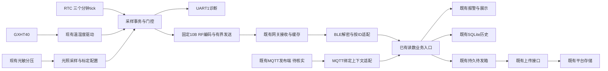
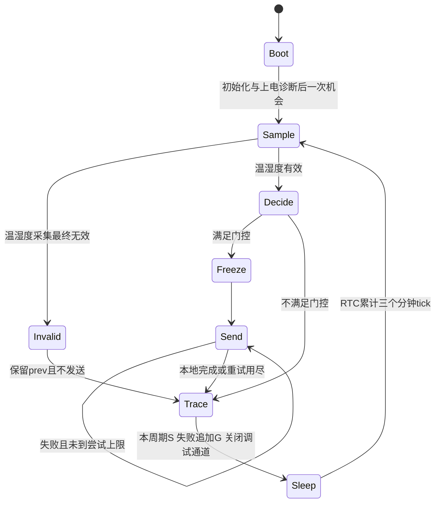
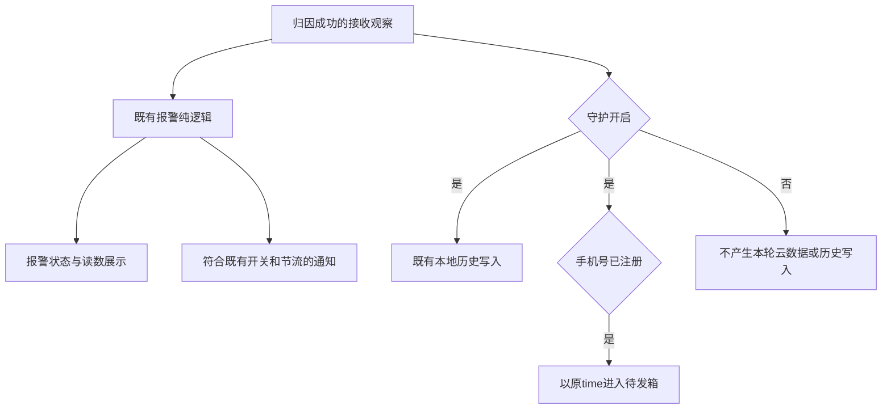

# 端云系统架构 SARCH-001

状态：DESIGN_READY（架构工件完成；未完成实现、独立验证与产品交付）。能力：system_architect.system_architecture。

本文件与 `system_decomposition.md`（SD-001）配套，基线为Git `009e10013ea5467224a1993ddeefe168bcb8e7df`。输入、证据版本、组件C01..C14、边界B01..B08、增量I01..I08和未决U01..U09均见SD-001；需求与验收仍以readme/PDR/PACC为准。消费AEX-001 Q1..Q7与SA-001，不把探索构造模型当真实业务通过。

## 1. 结构与复用

图中箭头表示已有责任和拟约束的数据流，不表示本轮已连通。EXT实际发布端未确认，不指定新服务或画成网关直连云。云上传与本地报警并列，网络成功不是报警前置。无新线程、数据库、总线、消息中间件或设备要求。

## 2. 架构决定与取舍

| 决定 | 采用方案及依据 | 明确舍弃的方案/代价 | 条件 |
|---|---|---|---|
| AD01 增量复用 | 采用AEX候选A：现有裸机+RTC、固定网关、App输入适配+业务+outbox | 不为局部修正引入RTOS/新云平台；跨层全量重写会扩大固定边界 | 无新增产品功能；专业模块内部可调整但不改变对外约束 |
| AD02 板端唯一门控 | 在C04按PDR升温/暗或超温判定；App不重算光照/上报原因 | 不用App纠正错误方向、不把下降报警改成板端门控；App拿不到被过滤样本 | 方向仍按当前原文；FB-04产品确认与真实覆盖保留U05 |
| AD03 采样与发送分离 | 每个机会形成一次业务结果；判定用旧prev；有效采集更新prev；触发样本冻结到发送结束 | 不用上次上报替prev，不积攒失败发送到下一周期，不加入心跳 | 有界重测属于同机会内部动作，不创建新业务样本 |
| AD04 有效性独立 | 数值与有效标记分离，光照无效不阻断超温，未标定不判暗 | 不用0、4095、旧默认或亮态基准作为失败回退/标定 | 合法0℃、0%RH保留；PA-001歧义交U08，不自行改验收 |
| AD05 BLE有效前缀 | 兼容现有固定160B属性：先16B对齐/成功解密，count>=1，长度至少16*(1+count)，仅按count取块 | 不把PSPEC等长表述直接实现成拒绝所有固定承载尾部；不按任意尾部生成设备 | U04要求正式接口同步和真实读回；尾部仅承载余量，不当额外遥测或完整性证明 |
| AD06 接收观察语义 | 当前BLE读回视为接收观察；内部明确来源和未知源时刻；传输重试复用原time | 拒绝AEX候选B的默认数值/哈希去重；它会丢失35.1℃等真实同值新报 | 不保证源事件恰一次；UI“最近上报”与真实接收冲突由U03关闭，未获决定不私改需求 |
| AD07 双输入不混同 | BLE按帧内ID，MQTT按同一绑定上下文顺序，汇聚现有业务入口 | 不猜外部桥接，不因个数相同就证明身份一致，不跨来源做无损去重承诺 | U06核实发布端、绑定和原time语义；数量不符拒整批 |
| AD08 本地独立与补传 | 复用SQLite、outbox、独立上传作用域和Mutex；异常分支彼此隔离 | 不等云成功才本地报警，不为重试造新时间，不追加可靠性服务 | HTTP/SQL的幂等只针对固定键；离线/未知响应恢复须独立验证 |
| AD09 可诊断但不改业务 | 诊断使用采样事务快照与发送结果，UART开启/关闭不改变判定 | 不以诊断重采样，不用串口输出作心跳或链路确认 | 行<=96B，p为判定前prev；U09量产策略不在本能力代决 |

AD05是架构层的兼容策略，不能代替正式接口契约与PACC；发现不符合固定网关真实读回时，凭原始证据反馈接口责任，不改网关“配合”此设计。AEX候选C新增序号/源时间/心跳可能解决部分信息缺口，但越出现有范围，本轮不采用。

## 3. 传感器事务和恢复状态

实现约束：

1. 上电初始化沿用现有代码与启动诊断；`have_prev=false`，不恢复历史Flash参数/霍尔/光通讯。启动只允许一次立即采样机会，不强制发射。
2. 光照采样先供电、稳定、多次ADC、关断；温湿度按既有地址探测、命令、等待、双CRC/量程流程。每个内部操作有配置上限。失败后的下一机会先做有界总线恢复并重探，不能永久依赖失效缓存地址。
3. 开始判定时快照 `previous_for_decision` 与 `had_previous`。无效温湿度不判定、不推进prev；有效温湿度按照 `cur>350 || (had_previous && light_valid && dark && (int32)cur-(int32)previous_for_decision>9)` 判定。
4. 判定后每个有效采集都推进prev，独立于是否发送/发送成功。温湿度和光照的有效性分开；35.0仍检查升温；超温不依赖光照/前值。
5. 门控触发时固定ID/T/RH和构帧输入，最多沿用200ms×3既有发送预算；不得在重试中重采样、变更数据或推进第二次prev。用尽则结束本轮，不保留跨周期待发送队列；下一机会按新采样重新判定。
6. 在发送结束后打印本周期S，`p/H`来自判定前快照，`q/r/s/y`分别表述有效性、门控、本地发送结果和尝试；采集失败追加G，失败数值不得解释为有效业务值。诊断输出不进入RF/App数据模型。
7. 结束时沿用清机会、PB05低、UART关闭、I2C释放和深睡路径；RTC中断与主循环的同步细节由固件专业保持原有机制，不丢/重消费机会。设计不新增补采样或追赶上报策略。

状态均为现有执行责任的约束，不要求引入状态机框架。采集内部重试/恢复与RF重试分别计数、分别诊断；本地发送完成不能打印或显示成远端确认。

## 4. App输入、报警与持久化状态

### 4.1 输入事务

BLE沿用现有连接→FFE2读→AES解密→GatewayFrameCodec；先完成帧级校验再产生读数，拒绝短帧、count=0、未对齐密文、解密失败和设备块不足。按count提取各设备块，负温保留符号、单位只除10一次。未知ID不能映射到任意已绑定ID；归因与业务处理之间保留绑定上下文，不以列表位置替代BLE帧内ID。

MQTT沿用ReadingAttribution：非法时间、空/非有限值、数量与绑定ID数不一致拒绝整批；同数量顺序错误不能从格式检测，手册和验证必须保留限制。时间首段作为原有上传time的来源，语义只按实际发布端证据解释，不能自动称为传感器采样时刻。App本机逗号发布与冒号订阅格式不假定互为对应，C09不新增桥接层。

内部逻辑记录可表述为：`device_id / temperature_C / humidity_pct / transport_source / received_at / original_time / source_sample_time=unknown / freshness=unproven`。这是接口责任的语义清单，优先通过现有参数/调用上下文表达，不强制新增类、字段、数据库表或上传DTO。BLE的original_time固定为本次接收时刻，MQTT为既有payload时间；重试不重新计算它。

一次成功BLE读取可能只是缓存重复；一次数值变化也不等价于确定的源时刻。C08/C09不能自行做跨来源或相同数值去重，不能把读取成功解释为传感器在线。现有消费者可处理接收观察，但UI/报告不能因此宣称发生新的物理采样或源上报；当前需求文字冲突须由U03关闭，禁止实现者自行把“最近上报”改成别的验收目标。

### 4.2 业务与失败隔离

图未改变既有报警启用条件：报警开关、优先级与900s规则由既有逻辑决定；守护/手机号门控不被擅自扩展到报警。云与历史分别尝试、分别记录失败，铃声/震动/UI异常不能跳过数据持久化尝试；本地历史写失败不冒充成功，也不能吞掉已可独立持久化的outbox项。系统不新增另一个可靠性存储，持续存储失败只报告，不承诺无损。

保留5/10/15min按时间取基准的双下降、超限严格比较及>65℃紧急优先且不节流；其他普通报警900s节流。数据不足时不得按样本序号假装分钟基准，也不填零补点。缓存可能重复触发业务的事实由U03保留；不得为了掩盖它偷偷改变紧急报警或普通节流规则。

条件门控会过滤真实降温；本设计保持既有App算法但不保证所有降温被观测。图表/早起报告以稀疏接收数据展示，不能从“没有新数据”推出环境稳定、无人蹬被、传感器离线或光照状态。

### 4.3 待发箱生命周期

`门控通过→持久化原键(dev_id,time)→取到期批次→上传→2xx删除；失败/超时/未知结果→保留原项并退避→下次现有触发机会重试`。达到既有maxAttempts时保留待发项，不新增无限重试或清库策略；运维需能识别未完成项。参数沿用当前CloudUploadRepository Config，默认批50、初始60s、上限1800s、maxAttempts20，属于现有实现配置，不在此升级为新产品指标。

Mutex避免同一进程并行取发；崩溃或服务端已提交但响应丢失时，依赖持久outbox和服务器固定键幂等。客户端2xx是既有成功判据，不是服务器已经正确实现唯一键的证据；必须做SQL独立读回。不同接收秒的同一源缓存形成不同键，以及同秒两个真实观察键碰撞，均不能靠原time重试解决，不宣称源数据恰一次。

## 5. 接口、时序和资源预算

| 项 | 设计采用 | 不承诺/需要验证 |
|---|---|---|
| 温湿度/光照 | 当前驱动常量：10ms测量等待、100ms光照稳定、最多8光照成功值、配置有界重读/重测 | 电气/装配正确性、真实稳定时间与标定可分离性；不从数字波形排除电气问题 |
| 周期/RF | RTC1min×3；发送200ms×3；上电一次机会 | 未确认LSI容差，±10%仍待FB-02；不把600ms当完整最坏执行时间 |
| UART | ≤96B，9600 8N1，S后失败追加G | 96B线时约100ms，不等于所有诊断耗时；不得干扰GPIOA/I2C/SWD |
| BLE | 180s轮询+现有手动读；固定属性兼容前缀 | 未同步的采样/轮询相位可能增加近一轮等待；断连/丢包无到达上界；实际MTU/长读未知 |
| 网关长度 | 属性160B与有效16*(1+N)分开 | 9为属性算术上限，不是支持9台；sensorres150B、发送500B和绑定数需交叉验证 |
| MCU资源 | 复用现有固定缓冲/状态，避免新增跨周期队列和动态任务 | FEX旧构建Flash20860B/RAM1792B仅作规模参考；新构建/栈峰值/功耗必须复核 |
| App/服务 | 复用既有SQLite/outbox/Retrofit/MQTT；CloudConfig为连接常量单一来源 | 不设置未要求的数据库容量/吞吐/续航指标；服务部署文档不是在线证据 |

故障恢复优先保证不伪造、可解释和有限等待，不把“再试”描述为必然成功。无新增传感器→网关或App→传感器控制协议。

## 6. 故障分域与恢复责任

| 故障域 | 结果/恢复 | 下游观察与责任 |
|---|---|---|
| GXHT无ACK/CRC错/超域 | 有界内部重试，最终无效；prev不变；下周期恢复总线并重探 | UART给具体错误；App没新数据不能区分硬件/门控；C02/C04处理，U01专业定位 |
| 光照全失败/未标定 | valid=false、dark=false；不走升温，超温独立 | 不合成暗态；C03及现场标定；U02未关不宣称完整门控可用 |
| 本地RF失败 | 尝试用尽结束本轮，冻结样本直到结束 | UART明确本地失败；不跨周期积压；真实远端状态仍未知 |
| BLE断连/非法帧 | 按现有有限连接窗口退出，下一轮/手动路径恢复；非法帧不产读数 | 原有历史保留，不把缓存/无数据补0或判传感器离线；C08 |
| MQTT数量/身份上下文不符 | 拒整批并记录原因；配置不一致交绑定责任 | 不静默截断/重排；等数量顺序错限制仍在U06 |
| UI/声音/震动异常 | 独立捕获记录，不吞后续存储/上传尝试 | 不伪称用户已被通知；C10与软件验证 |
| 本地DB/outbox写失败 | 各路径记录实际失败；不得先称入队成功 | 无新存储补救假设；C11/C12给可复现证据，不清数据掩盖 |
| HTTP断网/超时/失败 | 原键保留退避，恢复后由现有触发补传 | 数据库唯一键未证实前不宣称无重复；U07 |
| 进程/设备重启 | 传感器清prev；App复用持久历史/outbox，内存状态按现有初始化 | 不从旧RF值恢复板端prev，不把缓存重读当确定的新样本；恢复后当前版本独立核验 |

## 7. 部署、安全与证据交接

现有目标为传感器Keil工程、通过App发现的既有网关、Android候选APK和现有EMQX/abr.py/MySQL。具体执行入口与权限始终消费当前统一环境，不把本文路径/材料记载当执行授权。当前正式设计不主动操作硬件或环境，环境修复关闭；本次未访问手机/服务器、未构建/探测/烧录。

后续手册需分别记录当前提交/axf/APK/服务版本、板号/网关身份、配置、授权入口、原始结果和回滚；全暗标定绑定同板同供电与取样策略，回填sensor_config唯一配置点，不引入手机远程标定或Flash写参数功能。传感器升级回滚保持指定工程与算法，网关/iOS/硬件不作为本轮修改对象。不得把本节误作已写完操作手册或已完成演练。

云地址/端口及topic沿用PDR/CloudConfig；不在App加入管理凭据、不复制材料中的明文密码。HTTP明文和TLS主机名校验既有风险继续登记，本文不替责任人接受，也不借此新增认证架构。逻辑分析仪映射冲突仅保留核对依赖；不从旧观测自行改当前配置。

设计验证关联以SD-001增量表和PACC为准。特别保留：14规范向量与35.0边界、真实采集/恢复、真实全暗及有光反例、固定网关真实RF/BLE、缓存复读与同值新报、MQTT绑定顺序、上传未知响应后的SQL幂等、既有报警回归、独立手册演练与真实全链总测。原始模型、协议harness与真实目标证据各自标识，不能相互替代。

## 8. 未决事项和本次完成核对

U01..U09均由SD-001给出责任、关闭材料与影响。当前可以按AD01..AD09实现无条件或前置已具备的增量，但U03源身份与时间、U05检测覆盖等不可通过本架构文字消除；相关产品承诺与验收必须显式处理，不能用DESIGN_READY代替用户决定。固定边界保留不等于所有承诺已获可实现性证明。

本次完成组件责任、状态/数据流、边界契约、故障恢复、预算与可验证增量，未改其他专业源码/需求/验收文件。文档检查覆盖所有组件/边界/增量/未决编号、配套文件引用与UTF-8；清单同步。只有文档静态核对，无功能测试通过声明；本次启动的只读命令均结束，无遗留后台任务。
